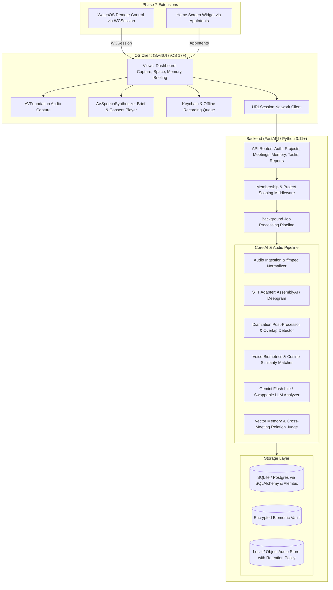

# EASE: Executive Discussion Capture, Accurate Diarization & Cross-Discussion Memory

EASE is an intelligent discussion intelligence platform consisting of a high-performance **FastAPI backend** and a native **SwiftUI iOS application** (with watchOS companion remote & Home Screen Widget). EASE captures in-person project discussions (strictly requiring affirmative consent), extracts structured commitments, decisions, claims, and prerequisites, links them to historical project discussions, and delivers spoken audio pre-meeting briefs.

---

## 1. System Architecture



---

## 2. Directory Structure

```
EasePrototype0/
├── .env.example                     # Environment template (API keys, secrets)
├── pyproject.toml                   # Python dependencies & pytest configuration
├── backend/
│   ├── alembic/                     # Database migrations
│   │   ├── env.py
│   │   └── versions/
│   ├── alembic.ini
│   ├── run_sample.py                # Phase 1 CLI runner
│   ├── eval_diarization.py          # Phase 2 Diarization evaluation harness
│   ├── data/eval/
│   │   └── truth_sample.json        # Ground truth evaluation template
│   ├── app/
│   │   ├── main.py                  # FastAPI application entry point
│   │   ├── config.py                # Pydantic Settings
│   │   ├── database.py              # Async SQLAlchemy engine & session maker
│   │   ├── core/                    # Security, encryption, JWT
│   │   ├── models/                  # SQLAlchemy ORM models (Postgres-ready)
│   │   ├── schemas/                 # Strict Pydantic v2 schemas
│   │   ├── services/                # Audio normalizer, postproc, speaker ID, memory engine
│   │   ├── adapters/                # AssemblyAI, Deepgram, Gemini, Claude adapters
│   │   ├── api/v1/                  # REST API routes (Auth, Projects, Meetings, Memory, Tasks)
│   │   └── prompts/domain/          # Versioned domain guidance prompt templates
│   └── tests/                       # Complete pytest suite (Phases 1 - 5)
└── ios/
    ├── project.yml                  # XcodeGen project specification
    ├── EasePrototype0.xcodeproj     # Generated Xcode project
    ├── EasePrototype0/              # iOS SwiftUI Application (iOS 17+)
    ├── EaseWatch/                   # WatchOS companion remote control
    └── EaseWidget/                  # iOS Home Screen Widget & AppIntent
```

---

## 3. Backend Setup & Quickstart

### Prerequisites
- Python 3.11+
- `ffmpeg` (installed via `brew install ffmpeg`)

### 1. Environment Configuration
```bash
cp .env.example .env
# Edit .env with your provider API keys:
# ASSEMBLYAI_API_KEY, DEEPGRAM_API_KEY, GEMINI_API_KEY
```

### 2. Install Dependencies & Run Database Migrations
```bash
python3 -m venv .venv
source .venv/bin/activate
pip install -e .
alembic upgrade head
```

### 3. Run the Backend API Server
```bash
uvicorn backend.app.main:app --reload --host 0.0.0.0 --port 8000
```
- Interactive API Docs: `http://127.0.0.1:8000/docs`
- Health check: `http://127.0.0.1:8000/health`

### 4. Running the Phase 1 CLI Sample Pipeline
```bash
python backend/run_sample.py sample.m4a --project-domain consulting --expected-speakers 3
```

### 5. Running the Test Suite
```bash
pytest backend/tests/ -v
```

---

## 4. Phase 2 Diarization Evaluation Harness

Compare diarization quality across AssemblyAI and Deepgram against ground-truth audio:

```bash
python backend/eval_diarization.py --audio test_site.wav --truth backend/data/eval/truth_sample.json --provider both
```

### Ground Truth Format (`truth.json`)
```json
{
  "test_case_id": "TC-01-consulting-hinglish",
  "description": "3-speaker discussion with Hinglish code-switching",
  "segments": [
    {
      "speaker": "Ashish",
      "start_ms": 1000,
      "end_ms": 4500,
      "text": "We need to finalize the API architecture before starting the frontend."
    }
  ]
}
```

### 4 Recommended Benchmark Recording Test Cases
1. **2 Speakers (Clean Audio)**: Clear turn-taking, minimal backchannel speech.
2. **3 Speakers (Strategy Discussion)**: Rapid interruptions and simultaneous affirmations.
3. **4+ Speakers (Roundtable)**: High overlapping speech regions and distant speaker placement.
4. **Noisy Site Audio (Construction / Ambient Noise)**: High background machinery and acoustic reverberation.
5. **Multilingual / Hinglish**: Rapid code-switching between Hindi and English phrases.

---

## 5. iOS App & Xcode Setup

### Opening in Xcode
1. Open the generated Xcode project:
   ```bash
   open ios/EasePrototype0.xcodeproj
   ```
2. Select the **EasePrototype0** scheme and choose any **iOS 17+ Simulator** (e.g., iPhone 15 Pro, iPhone 16).
3. Press **Cmd + R** to build and run.

### Re-generating Project with XcodeGen
If you modify `ios/project.yml`:
```bash
cd ios
xcodegen generate
```

### Supported Features in iOS App
- **Authentication**: JWT token storage in iOS Keychain.
- **Mandatory Consent Flow**: Consent checklist + spoken announcement via `AVSpeechSynthesizer` before recording starts.
- **Discussion Player**: Seekable audio scrubber; tap any claim, decision, or transcript segment to jump to its exact timestamp.
- **Cross-Discussion Memory**: Visual badges for `CONFIRMS`, `CONTRADICTS`, `UPDATES`, and `RESOLVES_PREREQUISITE`.
- **Pre-Meeting Audio Briefing**: 60-90s spoken executive script via `AVSpeechSynthesizer` with AirPods routing.
- **Apple Reminders / Calendar**: Export assigned prerequisites directly via EventKit.
- **Offline Queue**: Saves recordings locally when offline and flushes when reconnected.

---

## 6. Phase 7: Apple Watch Remote & Widget

- **Apple Watch Companion (`EaseWatch`)**: Provides a minimal remote Start/Stop interface via `WatchConnectivity`. Recording is strictly prohibited on the Watch until participant consent is affirmed on the iPhone.
- **Home Screen Widget (`EaseWidget`)**: Displays the next pending follow-up and a quick "Play Brief" action using iOS AppIntents.

---

## 7. Privacy, Biometrics & Data Governance

1. **Biometric Voice Vectors**: Voice embeddings are classified as sensitive biometric assets, encrypted at rest using AES-256 (Fernet) with keys held in `.env`, and isolated from general project metadata.
2. **Affirmative Per-Meeting Consent**: Recording is programmatically prevented from starting if any participant declines or if consent records are incomplete.
3. **Cascading Data Deletion**:
   - Deleting a meeting purges its audio binary, transcript, extracted items, embeddings, and memory links.
   - Deleting a user profile completely removes all associated biometric voice vectors.
   - Configurable audio retention policy automatically flags raw audio binaries for deletion after $N$ days while preserving structured knowledge.
